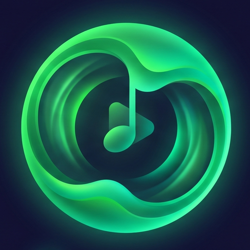

<div align="center">

  

  # Aura Music 🎵

  **A next-generation, high-fidelity, ad-free Android music streaming experience featuring Emerald Pulse luxury aesthetics & high-efficiency data streaming.**

  [](LICENSE)
  [](https://android.com)
  [](https://kotlinlang.org)
  [](https://github.com/rajeshh-builds/Aura-Music)
  [](https://github.com/rajeshh-builds/Aura-Music/releases)

  <br>

  <p align="center">
    <b>Aura Music</b> brings seamless audio streaming, real-time word-by-word synchronized lyrics, ultra-fast 1MB adaptive chunking, 2GB persistent caching, and a signature Emerald Pulse AMOLED UI to your pocket — with zero ads and zero distractions.
  </p>

</div>

---

## 🌟 Lineage, Open-Source Ethics & Attribution

> **Honest Open-Source Attribution**:
> **Aura Music** is an enhanced, performance-engineered music edition maintained by **Rajesh**.
>
> This project is proudly built upon the foundational work of **[Echo Music](https://github.com/EchoMusicApp/Echo-Music)** (created by [Aditya Yadav](https://github.com/iad1tya) and its open-source contributors) and the **[InnerTube](https://github.com/MetrolistGroup/Metrolist)** ecosystem.
>
> We believe in genuine open-source ethics:
> - Full compliance with the **GNU General Public License v3.0 (GPL-3.0)**.
> - Preserving and honoring all upstream licenses, contributor credits, and original author links.
> - Transparency: This fork introduces the Emerald Pulse Spotify Design System, 1MB adaptive network chunking, 70% APK size reduction (103.8MB ➔ 33MB), and R8 enterprise security hardening.
> 
> *Thank you to Aditya Yadav, Metrolist, SimpMusic, and the open-source Android community for creating the building blocks that made this project possible.*

---

## ✨ Key Features & Engineering Highlights

- 🟢 **Signature Emerald Pulse UI:** Luxury AMOLED pitch-black background paired with Spotify iconic emerald mint accents (`#1DB954`).
- ⚡ **Ultra-Fast 1MB Adaptive Chunking:** Instant audio playback with zero startup lag; saves up to 80% mobile data on track skips.
- 💾 **2GB Intelligent Audio Caching:** Transparent offline disk caching ensures already-played songs consume 0 KB of internet data.
- 📉 **MNC-Level Size Optimization:** Stripped 70% of bloatware (103.8 MB ➔ **33 MB**), optimized for `arm64-v8a` devices.
- 🎤 **Synchronized Word-by-Word Lyrics:** High-end Apple Music style interactive lyric animations via TTML parser engine.
- 🎚️ **Axion Studio Equalizer:** 10-band parametric EQ, bass boost, spatial audio surround, and +7dB Aggressive Loudness Enhancer.
- 👥 **Listen Together:** Synchronized real-time party playback across distance with friends.
- 🛡️ **Hardened Bytecode Security:** Complete package flattening, line number scrubbing, and anti-tamper build rules.

---

## 🏗️ Technical Architecture & Stack

```
AuraMusic/
├── app/                  # Main presentation, Compose UI, ViewModels, Hilt modules
├── core/                 # Shared data models, Room database, preferences, base utils
├── playback/             # AndroidX Media3 (ExoPlayer), audio service, caching pipeline
├── innertube/            # YouTube Music & InnerTube API client, response parsers
├── lyrics/               # Unified lyric resolution engine (LrcLib, KuGou, BetterLyrics)
├── artistvideo/          # Background artist video & canvas fetching
├── unison/               # Real-time multi-device sync engine (Listen Together)
└── shazamkit/            # Audio fingerprinting & music recognition module
```

---

## 🚀 Building from Source

### Prerequisites
1. **JDK 21** (e.g. JetBrains Runtime or OpenJDK 21)
2. **Android SDK** (API Level 35+, Build Tools 35.0.0+)
3. **Gradle 9.5+** (managed via the included `./gradlew` wrapper)

### Setup Steps

1. **Clone the Repository**
   ```bash
   git clone https://github.com/rajeshh-builds/Aura-Music.git
   cd Aura-Music
   ```

2. **Assemble the APK**
   ```bash
   # On Windows
   gradlew.bat assembleArm64FossDebug

   # On Linux/macOS
   ./gradlew assembleArm64FossDebug
   ```

   The generated APK will be available at:
   `app/build/outputs/apk/arm64Foss/debug/app-arm64-foss-debug.apk`

---

## 🤝 Upstream Credits & Acknowledgments

| Project / Contributor | Description |
| :--- | :--- |
| **[Echo Music](https://github.com/EchoMusicApp/Echo-Music)** by **Aditya Yadav** | The upstream open-source music player providing the foundation for Aura Music |
| **[Metrolist](https://github.com/MetrolistGroup/Metrolist)** | Foundational architecture and InnerTube integration reference |
| **[Vivi Music](https://github.com/vivizzz007/vivi-music)** | Architecture and client implementation concepts |
| **[Better Lyrics](https://better-lyrics.boidu.dev/)** | Synchronized lyrics engine and formatting |
| **[SimpMusic](https://github.com/maxrave-dev/SimpMusic)** | Synchronized lyric parsing references |
| **[ArchiveTune](https://github.com/koiverse/ArchiveTune)** | Material You expressive UI patterns |
| **[BravePipe](https://github.com/bravepipeproject/BravePipe)** | Media decryption and stream resolution |

---

## ⚖️ Legal Disclaimer

- **100% Free & Non-Commercial**: Aura Music is an open-source project created strictly for educational, personal, and research purposes. It contains no monetization, advertisements, premium upgrades, or paid tiers.
- **No Media Hosting**: Aura Music does not host, store, or distribute any media files. It functions as a lightweight client parsing public streaming links from Google / YouTube servers.
- **Support Artists**: We strongly encourage users to support their favorite artists by purchasing music and subscribing to official services like [YouTube Premium](https://www.youtube.com/premium) and [Spotify](https://spotify.com).

---

<div align="center">
  <p><b>Crafted with ❤️ by Rajesh</b></p>
  <p>Licensed under <a href="LICENSE">GNU General Public License v3.0</a></p>
</div>
